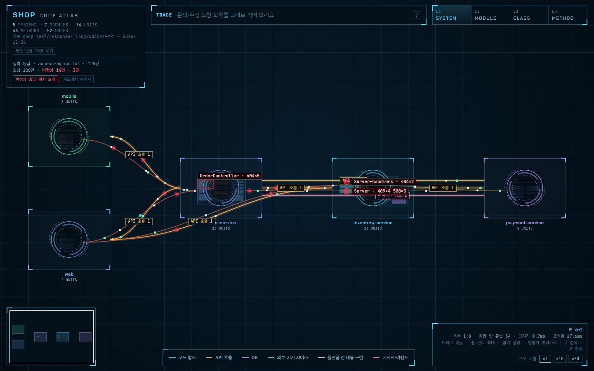
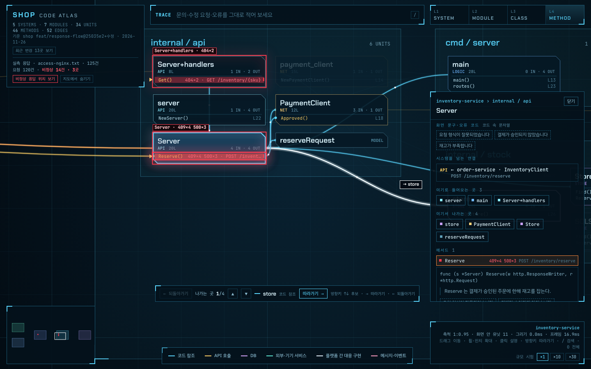
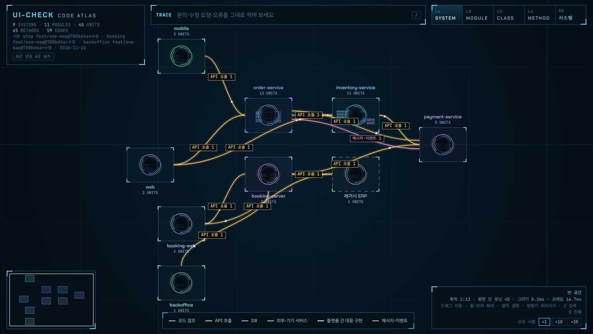

# CodeAtlas

여러 저장소(모바일 앱, 서버, 웹, DB 스키마)의 코드를 분석해 **한 장의 지도**로 보여 주는 도구다.
문의·수정 요청·오류가 들어왔을 때 "어디를 봐야 하는가"를 빨리 찾는 것이 목적이다.

- 시스템 → 모듈 → 클래스 → 메서드까지 끊김 없이 확대·축소한다(캔버스 2D, 핀치·휠·드래그).
- 클래스끼리의 호출뿐 아니라 **시스템을 넘는 연결**을 자동으로 잇는다: 앱이 부르는 API ↔ 서버 라우트, 코드 ↔ DB 테이블, 메시지 발행 ↔ 구독, 외부 서비스, 플랫폼 간 대응 구현.
- 검색창에 문의를 그대로 적으면 관련 위치가 지도에 켜진다. 화면에 보이는 문구나 오류 코드로도 찾는다.
- 유닛을 누르면 역할, 들어오고 나가는 곳, 메서드, 고쳤을 때 영향받는 범위를 보여 준다.
- API 마다 **요청이 어디서 들어와 어떤 응답 코드로 나가는지** 보여 준다. 접속 로그를 얹으면 실제 요청·응답이 연결선을 따라 흐르고, 비정상 응답이 나온 곳은 붉은 네온으로 깜박인다.
- **여러 제품의 앱·웹·서버를 한 지도에** 놓는다. 같은 서버를 여러 앱이 부르면 서버는 하나로 나오고, 소스가 없는 레거시는 "우리가 그쪽으로 보내는 요청"만으로 지도에 올린다.
- 폴더 추가, 레거시 등록, 다시 분석은 터미널 대신 **화면의 설정 패널**에서 할 수 있다. 시스템이 많으면 목록에서 눌러 이동하고, 상자를 끌어 자리를 정리한다.
- 분석 결과에는 **코드 본문을 넣지 않는다.** 이름, 시그니처, 주석, 호출 관계, 코드 속 문자열(비밀 값처럼 보이는 것은 제외)만 담는다.







위 그림은 저장소에 든 시험용 프로젝트(`fixtures/`)와 지어낸 접속 로그로 만든 것이다. 앞의 두 장은 `python3 tests/screenshot.py workspaces/shop <폴더>`, 마지막 장은 `node tests/ui-check.js <폴더>` 로 다시 찍는다.

## 구성

| 경로 | 내용 |
|---|---|
| `code-atlas.html` | 지도 화면. 파일 하나로 된 뷰어이고, 옆에 놓인 `atlas-data.json` 을 읽는다. 어떤 제품의 내용도 들어 있지 않다 |
| `atlas/` | 분석기. `atlas.py`(명령줄), `langs/`(언어 어댑터), `engine/`(공통 엔진), `rules/`(프레임워크 규칙 팩). 자세한 설명은 [atlas/README.md](atlas/README.md) |
| `fixtures/shop/` | 시험용 가짜 프로젝트(Java Spring, Python FastAPI, Go net/http, React, Kotlin Retrofit) |
| `tests/` | 뷰어 연기 시험, 실제 브라우저 화면 찍기, 파서 비교, 반출 검사 |
| `requirements-parsers.txt` | 선택 설치(tree-sitter). 없어도 동작한다 |
| `workspaces/` | 분석 대상별 작업 공간. **git 에서 제외된다** (아래 참고) |

분석기는 층으로 나뉘어 있어 한 프로젝트의 모양에 묶이지 않는다. 새 언어는 tree-sitter 명세 한 덩어리(또는 어댑터 파일 하나), 새 프레임워크는 규칙 JSON 하나를 더하면 되고, 연결 단계는 언어를 모른다.

## 빨리 써 보기

git 과 파이썬 3.9 이상만 있으면 된다(맥 기본 파이썬으로 충분하고, 추가 설치는 없다). 저장소에 들어 있는 시험용 프로젝트로 지도를 만들어 본다.

```bash
python3 atlas/atlas.py -w shop init
```

```bash
python3 atlas/atlas.py -w shop add fixtures/shop
```

```bash
python3 atlas/atlas.py -w shop sync
```

```bash
python3 atlas/atlas.py -w shop open
```

마지막 명령이 브라우저를 연다. `sync` 출력의 연결 수가 `'http': 3`, `'db': 2`, `'msg': 1` 이면 정상이다. 이때 Go 로 된 재고 서비스는 "건너뜀"으로 나온다(아래 선택 설치를 하면 함께 분석돼 `'http': 6` 이 된다).

## 내 프로젝트에 적용하기

`-w <이름>` 은 작업 공간 `workspaces/<이름>/` 을 가리킨다. **한 지도에서 보려는 것은 모두 한 작업 공간에 넣는다.** 제품이 여럿이어도 앱·웹·서버 저장소를 하나씩 `add` 하면 된다.

화면에서 하려면 작업 공간을 만들고 바로 연다. 빈 지도와 함께 설정 패널이 뜨고, 거기서 폴더를 골라 추가하면 분석까지 한다.

```bash
python3 atlas/atlas.py -w myproduct init
python3 atlas/atlas.py -w myproduct open
```

터미널로 하려면 다음과 같다.

```bash
python3 atlas/atlas.py -w myproduct init
python3 atlas/atlas.py -w myproduct add ~/work/ios-app --dry-run     # 무엇을 알아보는지 미리보기 (설정을 바꾸지 않는다)
python3 atlas/atlas.py -w myproduct add ~/work/ios-app               # 폴더 (읽기만 한다)
python3 atlas/atlas.py -w myproduct add ~/work/server
python3 atlas/atlas.py -w myproduct add git@host:team/admin-web.git  # git 주소 (작업 공간 안에 전용 복제본을 둔다)
python3 atlas/atlas.py -w myproduct sync
python3 atlas/atlas.py -w myproduct open
```

- 모바일 앱은 앱 이름으로 표시한다(`마이숍 iOS`, `마이숍 Android`). 화면에 보이는 이름(iOS 의 표시 이름, Android 의 `app_name`)을 먼저 찾고 없으면 프로젝트 이름을 쓴다. 이름은 설정 패널에서 고칠 수 있다.
- `add` 는 폴더를 훑어 시스템 종류(Xcode, Gradle, Nest, Next, Prisma, Spring, Python, Go 등)를 감지하고 `workspaces/myproduct/atlas.config.json` 에 적는다. 이름과 루트가 어색하면 그 파일을 고친다. 감지하지 못한 것은 [atlas/README.md](atlas/README.md) 의 설정 형식대로 직접 적는다.
- 코드가 바뀌면 `sync` 만 다시 돌린다. 바뀐 묶음만 다시 분석하고, 나중에 추가한 소스는 기존 접점(API, 테이블, 토픽)에 연결만 한다. 폴더 소스는 읽기만 하므로 최신으로 당기는 것은 직접 하거나 `sync --pull` 을 쓴다.
- `open` 은 이 컴퓨터(127.0.0.1)에서만 열리는 서버를 띄운다. 열어 둔 채 다른 터미널에서 `sync` 하면 화면에 새 버전 알림이 뜬다.
- 여럿이 볼 곳에 올릴 때는 `site` 로 만든 `workspaces/myproduct/site/` 폴더를 사내 웹 서버(로그인 뒤)에 둔다.
- `sync` 출력의 "호출자 없는 API" 가 많으면 그 제품이 쓰는 프레임워크의 규칙이 없다는 뜻이다. 규칙은 `workspaces/myproduct/rules/*.json` 에 더한다.

## 여러 제품을 한 지도에

서버가 여럿이면 API 경로만으로는 호출이 어느 서버로 가는지 정할 수 없다(`/api/orders/{id}` 가 두 서버에 다 있을 수 있다). 그래서 근거가 강한 순서로 가리고, 끝내 못 가리면 **틀린 선을 긋지 않고** "확인이 필요한 호출"로 남긴다.

| 순서 | 근거 | 어디서 오는가 |
|---|---|---|
| 1 | 레거시로 등록한 주소·경로 꼴·클라이언트 이름 | 설정 `external` |
| 2 | 호출에 적힌 서버 주소 | 코드의 `https://api…/x`, 또는 `{BASE}/x` 의 `BASE` 가 주소 상수일 때 + 설정 `hosts` |
| 3 | 경로가 맞는 서버가 하나뿐 | 자동 |
| 4 | 사람이 정한 것 | 설정 `link.calls` (애매하면 이 서버로), `link.never` (잇지 않는다) |
| 5 | 코드에 적힌 주소의 주인, 같은 저장소의 서버 | 자동 |
| 6 | 그 시스템의 다른 호출이 몰리는 서버 | 자동. 화면에 "추정"으로 표시 |

- **같은 서버는 한 번만 넣는다.** 그러면 여러 앱이 불러도 지도에는 하나로 나온다. 같은 폴더를 두 번 넣으면 막고, API 목록이 똑같은 서버가 둘이면 `sync` 가 알려 준다.
- **레거시(소스 없는 시스템)** 는 이름과 주소만 적어 등록한다. 우리 코드가 그쪽으로 보내는 요청이 API 단위로 모여 점선 상자 하나로 나온다. 등록하기 전에는 `sync` 와 설정 패널이 "지도에 없는 주소로 가는 호출"로 알려 주므로 거기서 골라 등록하면 된다.
- **개발·운영·검증 서버**처럼 코드는 같고 주소만 다른 경우에는 작업 공간을 나누지 않는다. 그 서버의 주소 칸에 주소를 모두 적으면 어느 주소로 가는 호출이든 서버 하나에 붙는다. 브랜치가 오래 갈라져 코드 자체가 다를 때만 작업 공간을 따로 만들고, git 주소와 브랜치로 소스를 추가한다.
- **확인이 필요한 호출** 은 왼쪽 위 상자와 설정 패널에 나온다. 유닛을 고르면 후보 서버가 주황 점선으로 보이고, 설정 패널에서 "○○ 로"를 누른 뒤 다시 분석하면 이어진다.

설정 파일에 직접 적을 때는 [atlas/README.md](atlas/README.md) 의 "설정 파일"을 본다.

## 연결이 안 보일 때: 연결 진단

앱과 서버 사이에 선이 없으면 셋 중 하나다. 서버가 내주는 API 를 못 읽었거나, 앱이 부르는 호출을 못 읽었거나, 둘의 경로가 다르다. 어느 쪽인지는 연결 진단이 알려 준다.

```bash
python3 atlas/atlas.py -w myproduct diagnose
```

시스템마다 "내주는 API 몇 개 · 부르는 호출 몇 개 중 이어진 것 몇 개"와, 못 이은 호출의 예와 API 의 예를 나란히 보여 준다. 설정 패널의 "연결 진단"에도 같은 내용이 나오고, 확인할 것이 있으면 왼쪽 위 상자와 `sync` 출력에도 뜬다.

- **경로 앞부분만 다른 경우**(게이트웨이나 WAS 가 붙이는 컨텍스트 경로, 기준 주소에 든 `/api`)는 자동으로 맞춘다. 같은 접두어를 떼거나 붙였을 때 맞는 호출이 여럿일 때만 그렇게 하고, 무엇을 맞췄는지 진단에 적는다. 자동으로 안 맞으면 설정 패널에서 서버의 "경로 접두어"를 적는다.
- **API 나 호출을 아예 못 읽은 경우**는 그 프레임워크의 규칙이 없는 것이다. 읽을 수 있는 서버 API 는 Spring MVC 어노테이션, NestJS, Express, FastAPI·Flask, Go 이고, 앱 호출은 Retrofit 어노테이션, `"$BASE_URL/경로"` 꼴, `get("경로")`·`request("경로")` 꼴, axios·fetch, requests 다. 그 밖의 것은 `workspaces/myproduct/rules/*.json` 에 규칙을 더한다([atlas/README.md](atlas/README.md)).

## 요청·응답 흐름과 비정상 응답

두 겹으로 보여 준다.

**코드에서 읽은 것 (항상 보인다).** 어느 메서드가 어떤 HTTP 상태 코드를 내려주는지 분석 때 함께 뽑는다(`http.Error(w, …, http.StatusConflict)`, `HTTPException(status_code=404)`, `throw new NotFoundException()`, `res.status(500)` 같은 자리와 그 줄에 적힌 문구). API 메서드를 고르면 설명 패널에 "이 요청이 받을 수 있는 응답 코드와 그것을 내려주는 자리"가 호출 경로를 따라 모여 나오고, 지도에서는 오류 응답을 내려주는 자리가 붉게 깜박인다. 메서드 줄 오른쪽 끝의 붉은 표시는 그 메서드가 400 이상의 코드를 내려준다는 뜻이다.

**접속 로그에서 온 실측 (로그를 줬을 때).** 로그의 `메서드 경로 상태코드` 를 분석해 둔 API 에 맞춰 라우트별 응답 코드 횟수를 만든다.

```bash
python3 atlas/atlas.py -w myproduct ingest /var/log/nginx/access.log
```

```bash
tail -f /var/log/app/access.log | python3 atlas/atlas.py -w myproduct ingest - --follow
```

- 지도에서 요청은 부르는 쪽 → 서버로 가는 흰 점, 응답은 서버 → 부르는 쪽으로 돌아오는 네모로 흐른다(정상 초록, 비정상 빨강).
- 비정상 응답(기본 400 이상, `--abnormal 500` 으로 바꾼다)이 나온 API 의 유닛은 **어느 배율에서도 붉은 네온으로 깜박이고**, 왼쪽 위 요약의 "비정상 응답 위치 보기"가 그곳들로 데려간다.
- 형식은 알아서 맞춘다: JSON 한 줄(`method`·`path`·`status` 류의 키), nginx·Apache 기본 형식, `GET /x … 200` 꼴의 앱 로그. 그 밖의 형식은 `--regex '(?P<method>…) (?P<path>…) (?P<status>\d{3})'` 로 알려 준다. 게이트웨이가 붙인 경로 접두어는 `--strip-prefix /v1` 로 뗀다.
- `--follow` 는 최근 5분 창을 3초마다 다시 적고, 열려 있는 화면은 10초 안에 따라온다. 지우려면 `ingest --clear`.
- 로그에서 가져오는 것은 메서드, 경로, 상태 코드, 걸린 시간뿐이다. 쿼리 문자열·본문·사용자 정보는 읽지 않고, 결과 파일(`atlas-runtime.json`)에는 라우트별 횟수만 남는다. 이 파일도 작업 공간에 생기므로 git 에 들어가지 않는다.

시험용 프로젝트로 보려면 다음을 실행한 뒤 `open` 한다.

```bash
python3 atlas/atlas.py -w shop ingest fixtures/shop/logs/access-nginx.txt
```

## 선택 설치: 정식 파서(tree-sitter)

기본은 내장 파서(Swift, Kotlin, TypeScript/JavaScript, Java, Python, Prisma)다. tree-sitter 를 깔면 Java·Python 을 정식 파서로 읽고, Go 처럼 내장 파서가 없는 언어도 분석한다.

```bash
python3 -m venv .venv && .venv/bin/pip install -r requirements-parsers.txt
```

깔고 나면 따로 할 일은 없다. `atlas.py` 가 `.venv` 를 스스로 찾아 쓴다. 문법은 언어별 패키지에 들어 있고 실행 중에 내려받는 것은 없다.

## 작업 공간: 분석 대상의 내용은 저장소에 넣지 않는다

이 저장소에는 도구만 둔다. 분석 대상 코드에서 나온 것은 전부 작업 공간 폴더에 두고, 작업 공간은 `.gitignore` 로 제외한다.

```
workspaces/<이름>/
  atlas.config.json     소스(폴더·git 주소), 시스템, 연결 설정
  atlas-data.json       분석 결과 (sync 가 만든다)
  atlas-manifest.json   버전, 소스별 기준 커밋, 지난 버전 대비 바뀐 유닛
  atlas-store/          묶음별 캐시, git 주소 소스의 전용 복제본
  atlas-notes.json      (선택) 사람이 쓴 유닛 설명, 예시 문의, 제품 용어, 시스템 색
  rules/*.json          (선택) 이 제품에서만 쓰는 규칙 팩. 내장 팩에 더해진다
```

커밋·푸시 전에 반출 검사를 돌린다. 작업 공간의 분석 결과를 기준으로, 저장소에 올라갈 파일에 분석 대상의 이름(유닛·모듈·파일 이름, API 경로, 호스트)이 들어 있으면 실패한다.

```bash
python3 tests/leak_check.py
```

화면 캡처에는 분석 대상의 클래스 이름이 그대로 찍힌다. 문서에 넣을 그림은 `fixtures/shop` 으로 만든 것만 쓴다.

## AI 기능

검색창에서 Enter 를 누르면 AI 가 문의의 경로를 추적하고, 유닛 설명도 AI 로 생성할 수 있다. AI 에게는 구조 정보만 보낸다(코드 본문 없음).
지금은 화면을 claude.ai 아티팩트로 게시했을 때만 켜진다. 사내 웹 서버에 정적 파일로 올리면 AI 는 꺼지고 키워드·문구 검색으로 동작한다.

## 여럿이 함께 쓸 때

- 현행화(`sync`)는 서버나 CI 한곳에서 돌린다. 잠금 파일이 겹쳐 도는 것을 막고, 결과는 한 번에 교체된다.
- git 주소로 등록한 소스는 전용 복제본을 원격 끝으로 옮겨 분석한다. 폴더로 등록한 소스는 읽기만 한다.
- 열려 있는 화면은 1분마다 목록표를 보고 새 버전이 나왔음을 알린다.
- 접근 토큰은 설정 파일에 적지 않는다. 접근 제어는 이 도구가 하지 않으므로 `site` 로 만든 폴더를 사내 로그인 뒤에 올린다.
- 설정 패널은 `open` 으로 띄운 로컬 서버에서만 켜진다. `site` 로 올린 화면에서는 보기만 한다. 로컬 서버는 이 컴퓨터에서 연 화면의 요청만 받는다(실행할 때 만든 토큰과 Host 를 확인한다).
- 시스템 자리는 한 번 놓이면 작업 공간의 `atlas-notes.json` 에 적혀 `site` 묶음에도 들어간다. 그래서 같이 쓰는 사람에게도 같은 배치로 보이고, 폴더를 더 추가해도 이미 있던 시스템은 움직이지 않는다(새 시스템만 빈자리에 놓인다).

## 조작

| 동작 | 방법 |
|---|---|
| 이동 · 확대 | 드래그 · 휠 또는 핀치 · `+` `-` · `0`(전체 보기) |
| 설정 메뉴 | 오른쪽 위 톱니바퀴 `설정` 단추. 아래 세 가지가 여기에 있다 |
| 시스템으로 이동 | 설정 메뉴의 "시스템으로 이동" 목록에서 누르기 (이름으로 거를 수 있다) |
| 시스템 자리 옮기기 | 설정 메뉴의 "시스템 자리 옮기기"를 켜고 상자를 끌기 → `완료`. 평소에는 끌어도 지도만 움직인다. `자동 정렬`은 전체를 다시 놓는다(한 번 더 눌러야 실행) |
| 프로젝트 설정 | 설정 메뉴의 "폴더 추가 · 레거시 · 다시 분석" (`open` 으로 열었을 때만). 폴더를 여러 개 넣을 때는 "추가만"으로 이어서 넣고 한 번에 분석한다 |
| 검색 | `/` 또는 `Cmd/Ctrl+K` |
| 추적 단계·검색 결과 넘기기 | 방향키 |
| 응답 흐름 보기 | API 메서드를 누른다(오류 응답 자리가 붉게 깜박인다). 실측이 있으면 왼쪽 위 "비정상 응답 위치 보기" |
| 연결 따라가기 | 유닛을 고른 뒤 `↑` `↓` 로 연결을 고르고 `→` 로 건너가기, `←` 로 돌아오기. 연결선을 직접 눌러도 된다 |
| 선택 해제 | `Esc` |

## 시험

```bash
node tests/viewer-smoke.js code-atlas.html workspaces/shop
```

가짜 DOM 으로 뷰어를 띄워 모든 유닛·확대 단계·검색·응답 표시·규모 시험(×10)을 통과하는지, 좌표가 제대로 잡혔는지 본다.

```bash
python3 tests/screenshot.py workspaces/shop /tmp/atlas-shots
```

실제 브라우저(헤드리스 Chrome)로 화면을 찍는다. 화면을 고쳤으면 이 그림을 직접 열어 본다. 가짜 DOM 시험은 지도가 통째로 비는 문제를 잡지 못한 적이 있다.

```bash
python3 tests/link_check.py
```

시험용 프로젝트 셋(`fixtures/shop` · `fixtures/booking` · `fixtures/backoffice`)을 한 작업 공간에 넣고, 경로가 겹치는 호출이 맞는 서버에 붙는지, 못 가리는 호출이 남는지, 함께 쓰는 서버가 하나로 나오는지, 레거시가 등록 전후로 제대로 나오는지 본다.

```bash
python3 tests/server_check.py
node tests/ui-check.js /tmp/atlas-ui
```

앞의 것은 로컬 서버의 설정용 주소(토큰·Host 확인, 폴더 추가, 레거시, 배치 저장, 다시 분석)를 본다. 뒤의 것은 실제 Chrome 에 마우스 입력을 넣어 시스템 목록, 배치 편집, 설정 패널을 끝까지 눌러 보고 화면을 찍는다.

```bash
.venv/bin/python tests/parser_parity.py java fixtures/shop/order-service
```

같은 소스를 내장 파서와 tree-sitter 로 각각 분석해 유닛·멤버·접점이 어디서 달라지는지 보여 준다(선택 설치를 했을 때). 시험용 프로젝트에서는 차이가 0건이어야 한다.

## 알아 둘 한계

- 내장 파서는 주석·문자열 제거와 괄호·들여쓰기 구조에 기댄 근사 분석이다. Swift, Kotlin, TypeScript/JavaScript 는 아직 내장 파서로만 읽는다.
- 어느 파서든 매크로, 리플렉션, 의존성 주입 설정처럼 문법에 드러나지 않는 연결은 놓친다.
- 규칙 팩이 없는 프레임워크의 접점은 잡히지 않는다. `sync` 출력의 "호출자 없는 API" 수가 빠진 곳을 찾는 실마리다.
- 실측은 접속 로그 수준이다. 어떤 API 가 어떤 코드로 응답했는지는 알지만, 서버 안의 어느 메서드에서 실패했는지는 로그에 없어서 코드에서 읽은 "그 코드를 내려주는 자리"로 좁혀 보여 준다. 요청 한 건을 시스템 사이로 따라가려면 분산 추적(OpenTelemetry 등) 기록이 필요한데 아직 읽지 못한다.
- 같은 API 를 여러 클라이언트가 부르면 로그만으로는 누가 불렀는지 나눌 수 없어, 그 API 로 들어오는 연결선마다 같은 통행량을 그린다.
- 코드에서 읽는 응답 코드는 규칙 팩이 아는 관용구만 잡는다. 예외 이름으로 어림한 코드(`OrderNotFoundException` → 404)는 `404?` 처럼 물음표를 붙인다.
- 요청·응답의 본문 값은 다루지 않는다.
- 호출 대상은 코드에 보이는 근거로만 가린다. 서버 주소를 환경 변수나 배포 설정에서 읽는 앱은 주소가 코드에 없으므로 "하나뿐"·"주로 부르는 서버"에 기대고, 그래도 안 되면 사람이 정해야 한다.
- 레거시는 우리 코드와 맞닿는 경계만 보인다. 레거시 안쪽과, 레거시가 우리 서버를 부르는 방향은 소스가 없어 알 수 없다.
- 시스템이 수십 개인 실제 규모에서의 배치와 속도는 아직 확인하지 못했다(지어낸 시스템 29개로만 봤다). 자동 배치는 한 열이 너무 길어지면 여러 줄로 나누고, 시스템 사이 선이 많으면 이름표를 가리킨 선에만 붙인다. 그래도 어지러우면 상자를 끌어 정리한다.

## 라이선스

MIT. [LICENSE](LICENSE) 참고.
